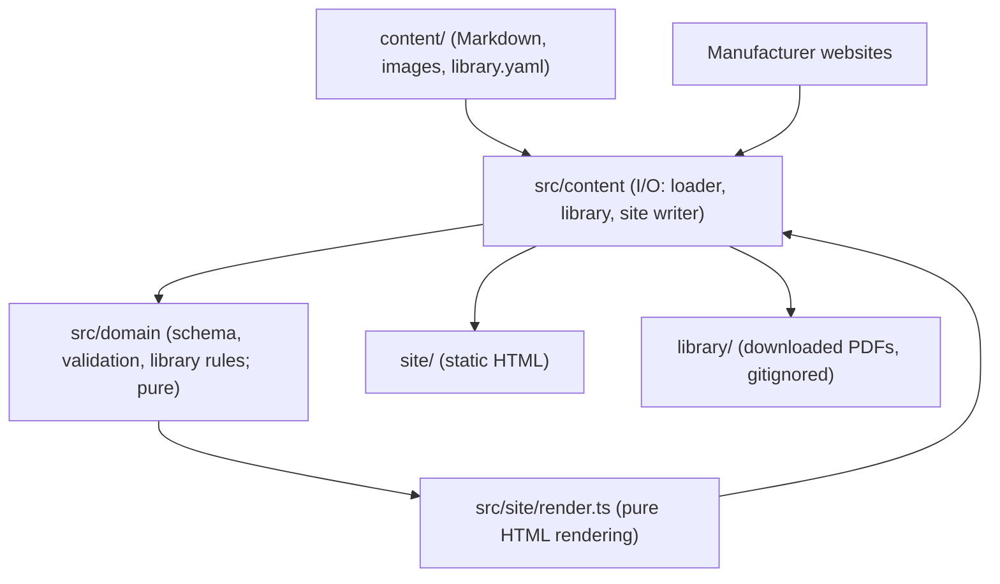

# BASWiki - System Architecture

## High-Level Structure

## Directory Layout
- `src/domain/` - Pure schema and validation (pages, document manifest, download classification); no filesystem or network access
- `src/content/` - I/O layer: markdown loader, document library (download, hash, verify), site writer
- `src/site/render.ts` - Pure HTML rendering: pages and manifest in, HTML, CSS, JS and the search index out
- `src/site/styles.ts`, `src/site/client.ts` - Site stylesheet and dependency-free client script (header search, table filters, click-to-copy part numbers)
- `src/cli.ts` - `validate`, `build`, `fetch`, `ingest`, `verify` commands (`npm start -- <command>`)
- `src/domain/comms.ts`, `src/content/comms.ts` - Parsing and status for the multi-agent `comms/` folder (claims and messages; see `comms/README.md`)
- `comms/` - Agent coordination files: tracked `README.md` and `BOARD.md`, gitignored `claims/` and `messages/`
- `src/index.ts` - Public API (`validateContent`)
- `content/` - Wiki pages (`pages/`), images (`images/`), and the document manifest (`library.yaml`)
- `library/` - Downloaded manufacturer PDFs, gitignored; indexed by `content/library.yaml` (see `library/README.md`)
- `site/` - Generated static site, gitignored
- `tests/` - Phase-organized unit and integration test suites
- `docs/` - Living design, roadmap, architecture, and agentic workflow documentation
- `.agents/skills/` - Specialized instructions and workflows for AI coding agents

## Module Boundary Rules
1. Modules inside the core domain must not depend on server, CLI, or UI entrypoints.
2. Circular dependencies between modules are prohibited (enforced via `npm run depcruise`).
3. Cross-boundary communication uses explicit DTOs or value objects.
4. Dates, network responses, and file existence are injected into pure modules (for example `today` in `downloadMissing`, `hasFile` in `renderSite`) so results are reproducible.
