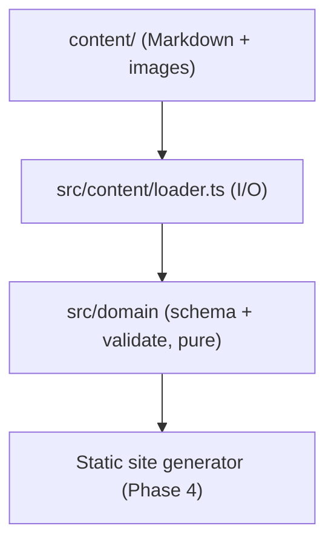

# BASWiki — System Architecture

## High-Level Structure

## Directory Layout
- `src/` — Source modules organized by domain boundary
- `tests/` — Phase-organized unit and integration test suites
- `docs/` — Living design, roadmap, architecture, and agentic workflow documentation
- `.agents/skills/` — Specialized instructions and workflows for AI coding agents

## Module Boundary Rules
1. Modules inside the core domain must not depend on server, CLI, or UI entrypoints.
2. Circular dependencies between modules are prohibited (enforced via `npm run depcruise`).
3. Cross-boundary communication uses explicit DTOs or value objects.
